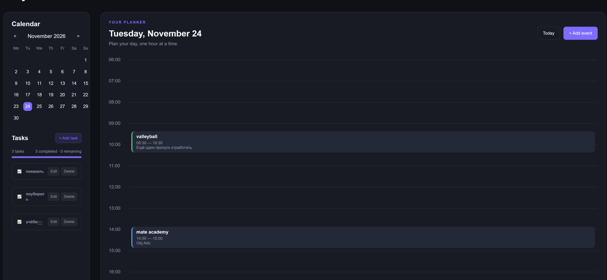
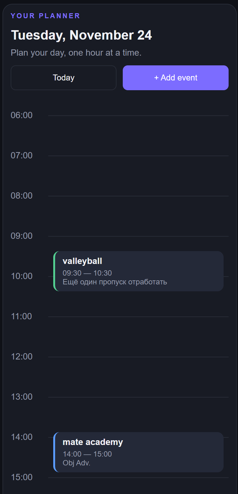

# daily. — Daily Planner

A minimalistic daily planner built with Vanilla JavaScript, SCSS, and LocalStorage.

The application helps users organize their daily schedules, manage tasks, and track completed activities through an interactive calendar and timeline.

## Features

## Screenshots


### Desktop


### Mobile



### Event Management
- Create, edit, and delete events
- Set event names, dates, times, categories, and descriptions
- Prevent overlapping events
- Validate form input and time ranges
- Confirm before deleting an event

### Task Management
- Create tasks for different dates
- Edit and delete tasks
- Mark tasks as completed
- Track completed and remaining tasks
- Confirm before deleting a task

### Interactive Calendar
- Navigate between months
- Select a date to display its schedule and tasks
- Quickly return to the current date
- Automatically navigate to an event's date after saving it

### Data Persistence
- Store events and tasks in LocalStorage
- Keep data after page reloads

### Responsive Design
- Dark minimalistic interface
- Responsive layout for smaller screens
- Custom modal windows and form validation

## Tech Stack

- HTML5
- SCSS
- Vanilla JavaScript (ES6+)
- LocalStorage
- Parcel

## Getting Started

### Prerequisites

- Node.js
- npm

### Installation

Clone the repository:

```bash
git clone https://github.com/nezerixces/daily-planner.git
```

Navigate to the project directory:

```bash
cd daily-planner
```

Install dependencies:

```bash
npm install
```

### Run Locally

```bash
npm start
```

Parcel will start the development server.

### Production Build

```bash
npm run build
```

The production files will be generated in the `dist` directory.

## Project Structure

```text
daily-planner/
├── src/
│   ├── scripts/
│   │   ├── main.js
│   │   ├── events.js
│   │   ├── tasks.js
│   │   └── storage.js
│   ├── styles/
│   │   ├── main.scss
│   │   ├── variables.scss
│   │   └── blocks/
│   └── index.html
├── package.json
└── README.md
```

## Data Storage

The application uses the browser's LocalStorage API to persist events and tasks.

No external database or backend is required.

## Future Improvements

- Add drag-and-drop event scheduling
- Add recurring events
- Improve accessibility
- Add data export and import

## Author

**Nazar**

[GitHub Profile](https://github.com/nezerixces)


